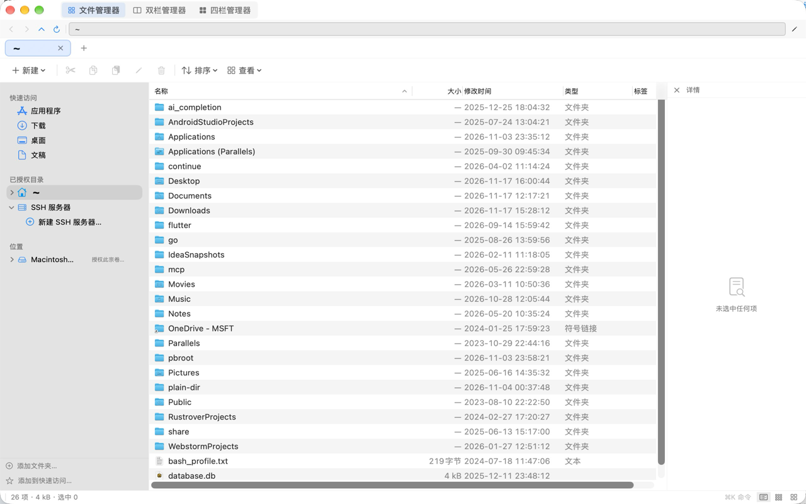

  

<h1 align="center">FileExplorer8</h1>

<strong>Нативный файловый менеджер для macOS · Файловый менеджер / два раздела / четыре раздела в одном окне</strong>

Одно ядро операций, три модели взаимодействия · Пробный запуск перед записью · Три уровня отмены · Без подтормаживаний на десятках тысяч элементов

  
  
  

<a href="README.md" hreflang="zh-Hans" lang="zh-Hans">简体中文</a> · <a href="README.zh-Hant.md" hreflang="zh-Hant" lang="zh-Hant">繁體中文</a> · <a href="README.en.md" hreflang="en" lang="en">English</a> · <a href="README.ja.md" hreflang="ja" lang="ja">日本語</a> · <a href="README.ko.md" hreflang="ko" lang="ko">한국어</a> · <a href="README.de.md" hreflang="de" lang="de">Deutsch</a> · <a href="README.fr.md" hreflang="fr" lang="fr">Français</a> · <a href="README.es.md" hreflang="es" lang="es">Español</a> · <a href="README.pt-BR.md" hreflang="pt-BR" lang="pt-BR">Português (Brasil)</a> · <strong>Русский</strong> · <a href="README.vi.md" hreflang="vi" lang="vi">Tiếng Việt</a> · <a href="README.id.md" hreflang="id" lang="id">Bahasa Indonesia</a> · <a href="README.ms.md" hreflang="ms" lang="ms">Bahasa Melayu</a> · <a href="README.th.md" hreflang="th" lang="th">ไทย</a>

---

## Что это

FileExplorer8 — это **файловый менеджер**, работающий нативно в macOS. Он объединяет три модели взаимодействия — файловый менеджер, два раздела и четыре раздела — в одном окне, переключаясь по `⇧⌘D`. Каждый режим хранит своё состояние: путь, вкладки, сортировку, ширину столбцов, выделение. Переключайтесь туда и обратно — ничего не теряется.

Это не замена Finder и не ещё одна его оболочка. Он закрывает то, чего не хватает Finder: **массовые переносы, когда обе руки на клавиатуре**.

Ориентир — классический двухпанельный файловый менеджер: он не назначает приложение по умолчанию, не устанавливает расширение Finder и не читает и не пишет настройки Finder. Общая только сама файловая система — поэтому он может годами жить рядом с Finder, не мешая друг другу.

---

## Снимки экрана

### Файловый менеджер: сетка с панелью сведений

### Два раздела: источник и назначение

### Четыре раздела: сетка 2×2

---

## Возможности

### Пробный запуск перед любой записью

Перед копированием, перемещением или перезаписью выполняется пробный запуск: можно ли писать в цель, хватает ли места, какие имена конфликтуют — всё показывается заранее. **На этом шаге не записывается ни один байт.**

Четыре стратегии конфликта: заменить (сначала резервная копия, отмена поддерживается), сохранить оба, пропустить, спросить по каждому. При пяти конфликтах и меньше можно решать по одному.

В ходе работы видны реальная скорость, передано / всего / осталось, а в конце — полный отчёт: сколько успешно, сколько пропущено, сколько с ошибкой, причём каждая ошибка названа вместе с причиной.

### Три уровня отмены

Перемещение в пределах тома, переименование, удаление в Корзину, упаковка и распаковка ZIP **гарантированно отменяемы на 100 %**. Копирование и перемещение между томами — по возможности. То, что отменить нельзя, требует подтверждения до выполнения.

### Шесть вариантов вида и настоящий просмотр

Очень крупные / крупные / средние / мелкие значки, список и подробности. Значки выбираются в реальном размере в пикселях (256 / 128 / 64 / 32), поэтому на Retina они не размываются.

Нажмите `Пробел` для просмотра, затем `←` / `→` или `PgUp` / `PgDn` для перехода:

- Текст и исходный код открываются в режиме только для чтения моноширинным шрифтом, с подсветкой синтаксиса более 50 языков и номерами строк
- PDF отрисовывается через PDFKit
- Изображения масштабируются так, чтобы целиком помещаться в панели с сохранением пропорций
- Форматы с оформлением передаются системному Quick Look
- Для того, что показать нельзя, выводится информационная карточка

### Упаковка и распаковка

**Создать ZIP**: ZIP64, настраиваемый уровень сжатия, уже сжатые форматы пропускаются автоматически, можно следовать символическим ссылкам, результат отменяем.

**Двойной щелчок для распаковки**, как в Finder: единственная папка верхнего уровня не вкладывается, при конфликте переименовывается весь архив, очищается только `__MACOSX`, права Unix восстанавливаются.

### Удалённые папки SSH

Встроенный SSH / SFTP: подключение по паролю или приватному ключу из любого пути, после чего удалённые папки просматриваются, копируются, удаляются, переименовываются и отменяются так же, как локальные, — через тот же конвейер записи.

Панель вкладок отмечает подключения значком сетевого диска и красно-зелёным состоянием, а после обрыва переподключается одним щелчком. **Пароль можно не сохранять** — вместо него при каждом подключении будет разовый запрос входа. Удалённые файлы до 10 МБ просматриваются мгновенно.

### Подробности

- Семь цветных меток Finder, накладываются друг на друга; при снятии всех остаётся собственная текстовая метка
- Палитра команд `⌘K`, порядок: степень совпадения → недавние → по алфавиту
- Три действия с путём: копировать путь, копировать путь родительской папки, копировать имя файла, плюс «Открыть в Терминале»
- Контрольные суммы: SHA-256 / SHA-512 / SHA-1 / MD5 / BLAKE3 / CRC32 / CRC64
- Тома находятся автоматически: USB-накопители, внешние диски, смонтированные образы — извлечение одним щелчком
- Восстановление сеанса: положение окна, вкладки, ширина столбцов, сортировка и пропорция панелей запоминаются; после сбоя очередь записи продолжается
- Двустороннее копирование и вставка с Finder, перетаскивание во все три стороны
- Переключение языка — в меню «Язык» верхнего уровня: один шаг, применяется сразу

### 14 языков

Китайский упрощённый и традиционный, английский, японский, корейский, немецкий, французский, испанский, бразильский португальский, русский, вьетнамский, индонезийский, малайский, тайский.

Для тайского реализовано собственное правило сортировки: предшествующие гласные, тоновые знаки и порядок письменностей не совпадают с порядком кодовых точек, поэтому сортировка по кодовым точкам перемешала бы список.

---

## Конфиденциальность

**Данные не собираются.** Нет учётных записей, аналитики, рекламных SDK и отчётов о сбоях.

Кроме SSH-подключений, которые вы запускаете сами, приложение не отправляет ни одного байта на какой-либо сервер. Ваши файлы, история и учётные данные серверов остаются на вашем Mac: пароли и парольные фразы — в системной связке ключей, файлы приватных ключей — там, где вы их положили.

Приложение работает в App Sandbox и читает или записывает только в выданных вами папках. Оно не запрашивает контакты, камеру, микрофон, запись экрана и полный доступ к диску.

[Прочитать полную политику конфиденциальности](https://rosesmall2010.github.io/FileExplorer8/privacy.ru.html)

---

## Поддержка

Что-то не работает, есть идея или нашли ошибку?

- Загляните на [страницу поддержки](https://rosesmall2010.github.io/FileExplorer8/) — там частые вопросы
- Или создайте [обращение](https://github.com/rosesmall2010/FileExplorer8/issues), указав версию macOS, версию FileExplorer8 и шаги воспроизведения

Версия указана в «FileExplorer8 › О программе FileExplorer8».

### Частые вопросы

**Почему при открытии некоторых папок запрашивается разрешение?**
Приложение работает в App Sandbox. Рабочий стол, Загрузки, Документы и внешние диски находятся вне песочницы, поэтому macOS спрашивает при первом входе в такую папку. Это задуманная система безопасности, а не дефект. Выберите «Разрешить доступ к этой папке» — папка запомнится, и для одного пути в рамках одного запуска вопрос задаётся один раз.

**Приложение читает мои контакты, камеру или экран?**
Нет. FileExplorer8 запрашивает только доступ к выбранным вами файлам, стандартным папкам (Загрузки / Документы / Музыка / Изображения / Фильмы) и исходящий доступ в сеть. Доступа к контактам, камере, микрофону, записи экрана и всему диску нет.

**Где хранятся пароли SSH?**
В связке ключей macOS. Конечные точки серверов лежат в локальном контейнере песочницы и зашифрованы AES-256-GCM. Пароль можно не сохранять и вместо этого получать одноразовый запрос входа при каждом подключении. Подробнее в <a href="https://rosesmall2010.github.io/FileExplorer8/privacy.ru.html">политике конфиденциальности</a>.

**Работает ли на Apple Silicon и Intel?**
На обоих. Установщик — универсальный двоичный файл. Требуется macOS 15.0 или новее.

**Как убрать остатки после удаления?**
Удалите приложение, затем удалите <code>~/Library/Containers/com.donghuazhu.FileExplorer8/</code>, чтобы очистить настройки, состояние сеанса и конечные точки серверов (данные приложений в песочнице хранятся в этом контейнере, а не в общих местах системы). Пароли SSH находятся в связке ключей и исчезают вместе с подключением.

---

## Системные требования

- macOS 15.0 или новее
- Apple Silicon или Intel (универсальный двоичный файл)

---

macOS — товарный знак Apple Inc. Приложение не связано с Apple Inc.

