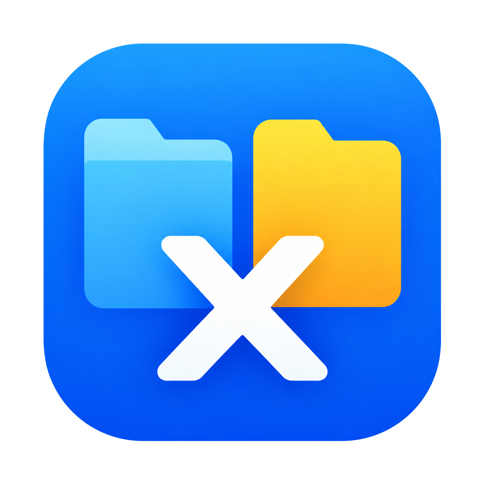
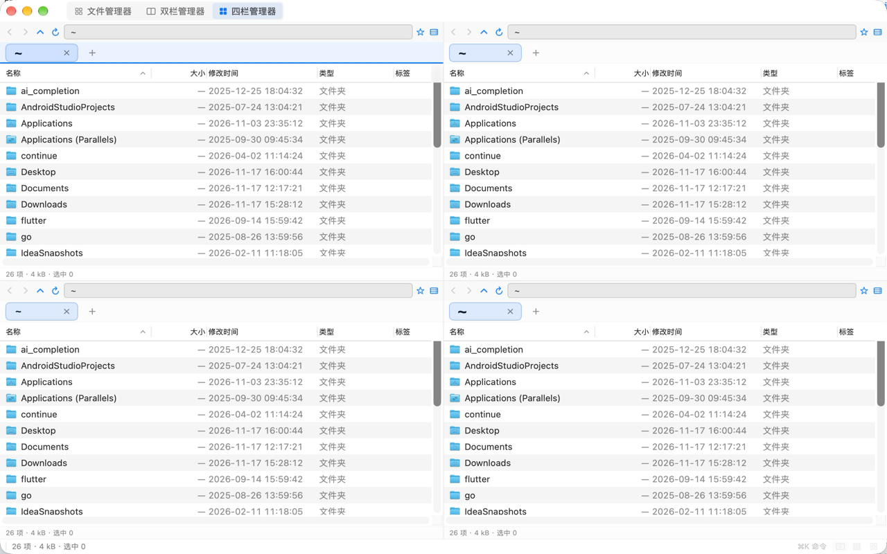

  

<h1 align="center">FileExplorer8</h1>

<strong>Trình quản lý tệp gốc macOS · Quản lý tệp / hai khung / bốn khung trong một cửa sổ</strong>

Một lõi thao tác tệp, ba mô hình tương tác · Chạy thử trước mọi thao tác ghi · Hoàn tác ba mức · Không giật với hàng chục nghìn mục

  
  
  

<a href="README.md" hreflang="zh-Hans" lang="zh-Hans">简体中文</a> · <a href="README.zh-Hant.md" hreflang="zh-Hant" lang="zh-Hant">繁體中文</a> · <a href="README.en.md" hreflang="en" lang="en">English</a> · <a href="README.ja.md" hreflang="ja" lang="ja">日本語</a> · <a href="README.ko.md" hreflang="ko" lang="ko">한국어</a> · <a href="README.de.md" hreflang="de" lang="de">Deutsch</a> · <a href="README.fr.md" hreflang="fr" lang="fr">Français</a> · <a href="README.es.md" hreflang="es" lang="es">Español</a> · <a href="README.pt-BR.md" hreflang="pt-BR" lang="pt-BR">Português (Brasil)</a> · <a href="README.ru.md" hreflang="ru" lang="ru">Русский</a> · <strong>Tiếng Việt</strong> · <a href="README.id.md" hreflang="id" lang="id">Bahasa Indonesia</a> · <a href="README.ms.md" hreflang="ms" lang="ms">Bahasa Melayu</a> · <a href="README.th.md" hreflang="th" lang="th">ไทย</a>

---

## Đây là gì

FileExplorer8 là một **trình quản lý tệp** chạy gốc trên macOS. Nó gom ba mô hình tương tác — quản lý tệp, hai khung và bốn khung — vào một cửa sổ, chuyển vòng bằng `⇧⌘D`. Mỗi chế độ giữ trạng thái riêng: đường dẫn, thẻ, cách sắp xếp, độ rộng cột, mục đang chọn. Chuyển qua lại không mất gì.

Đây không phải bản thay thế Finder, cũng không phải một lớp vỏ khác của Finder. Nó lấp phần Finder còn thiếu: **di chuyển hàng loạt khi cả hai tay đặt trên bàn phím**.

Mốc tham chiếu là trình quản lý tệp hai khung cổ điển: không đặt ứng dụng mở mặc định, không làm tiện ích mở rộng Finder, không đọc hay ghi tuỳ chọn của Finder. Thứ duy nhất dùng chung là chính hệ thống tệp. Vì vậy nó có thể sống lâu dài bên cạnh Finder mà hai bên không cản trở nhau.

---

## Ảnh chụp

### Quản lý tệp: dạng lưới kèm bảng chi tiết

### Hai khung: nguồn và đích

### Bốn khung: bố cục 2×2

---

## Tính năng

### Chạy thử trước mọi thao tác ghi

Trước khi sao chép, di chuyển hay ghi đè, ứng dụng chạy thử: đích có ghi được không, còn đủ chỗ không, tên nào trùng — tất cả hiện ra trước. **Bước này không ghi một byte nào.**

Bốn cách xử lý xung đột: thay thế (sao lưu trước, có hoàn tác), giữ cả hai, bỏ qua, hỏi từng mục. Với năm xung đột trở xuống, bạn quyết từng cái một.

Tiến trình hiện tốc độ thực, đã chuyển / tổng / còn lại, và kết thúc bằng bảng tổng kết: bao nhiêu thành công, bỏ qua, thất bại — mỗi mục thất bại được nêu tên kèm lý do.

### Hoàn tác ba mức

Di chuyển trong cùng ổ, đổi tên, xoá vào Thùng rác, nén và giải nén ZIP **được bảo đảm hoàn tác 100%**. Sao chép và di chuyển khác ổ là cố gắng tối đa. Thao tác không hoàn tác được sẽ hỏi xác nhận trước khi chạy.

### Sáu bố cục và xem trước thực chất

Biểu tượng rất lớn / lớn / vừa / nhỏ, danh sách và chi tiết. Biểu tượng được chọn theo kích thước điểm ảnh thật (256 / 128 / 64 / 32) nên không bị nhoè trên màn hình Retina.

Nhấn `Dấu cách` để xem trước, rồi `←` / `→` hoặc `PgUp` / `PgDn` để đi tiếp:

- Văn bản và mã nguồn mở ở chế độ chỉ đọc, phông đơn cách, có tô sáng cú pháp hơn 50 ngôn ngữ và số dòng
- PDF hiển thị qua PDFKit
- Ảnh được thu phóng vừa khít bảng mà giữ đúng tỉ lệ
- Định dạng phức tạp giao cho Quick Look của hệ thống
- Thứ không hiển thị được sẽ nhận một thẻ thông tin

### Nén và giải nén

**Tạo ZIP**: ZIP64, mức nén điều chỉnh được, định dạng đã nén được tự động bỏ qua, tuỳ chọn đi theo liên kết tượng trưng, và kết quả hoàn tác được.

**Nhấn đúp để giải nén**, hành vi giống Finder: một thư mục cấp cao nhất duy nhất không bị lồng thêm, khi trùng tên thì đổi tên cả gói, chỉ dọn `__MACOSX` và khôi phục bit quyền Unix.

### Thư mục SSH từ xa

SSH / SFTP tích hợp: kết nối bằng mật khẩu hoặc khoá riêng tư ở bất kỳ đường dẫn nào, rồi duyệt, sao chép, xoá, đổi tên và hoàn tác trên máy từ xa y như cục bộ — qua cùng một đường ống ghi.

Thanh thẻ đánh dấu kết nối bằng biểu tượng ổ mạng và trạng thái đỏ hoặc xanh, và kết nối lại bằng một cú nhấn sau khi rớt. **Có thể không lưu mật khẩu**, thay bằng hộp đăng nhập một lần cho mỗi kết nối. Tệp từ xa tới 10 MB xem trước tức thì.

### Chi tiết

- Bảy nhãn màu của Finder, xếp chồng được; bỏ hết nhãn vẫn giữ một nhãn chữ tự đặt
- Bảng lệnh `⌘K`, sắp theo độ khớp → dùng gần đây → bảng chữ cái
- Bộ ba đường dẫn: sao chép đường dẫn, sao chép đường dẫn thư mục cha, sao chép tên tệp, kèm “Mở trong Terminal”
- Tổng kiểm tra: SHA-256 / SHA-512 / SHA-1 / MD5 / BLAKE3 / CRC32 / CRC64
- Ổ đĩa tự phát hiện: USB, đĩa ngoài, ảnh đĩa đã gắn sẽ tự xuất hiện, tháo ra bằng một cú nhấn
- Khôi phục phiên: vị trí cửa sổ, thẻ, độ rộng cột, cách sắp xếp và tỉ lệ hai khung đều được nhớ; thao tác ghi đang xếp hàng tiếp tục sau khi ứng dụng gặp sự cố
- Sao chép và dán hai chiều với Finder, kéo thả thông suốt cả ba hướng
- Chuyển ngôn ngữ nằm ở menu Ngôn ngữ cấp một — một bước là tới, áp dụng ngay

### 14 ngôn ngữ

Trung giản thể, Trung phồn thể, Anh, Nhật, Hàn, Đức, Pháp, Tây Ban Nha, Bồ Đào Nha (Brazil), Nga, Việt, Indonesia, Mã Lai, Thái.

Tiếng Thái có quy tắc sắp xếp riêng — nguyên âm đứng trước, dấu thanh và thứ tự chữ viết đều không theo thứ tự điểm mã, nên sắp theo điểm mã sẽ bị lộn xộn.

---

## Quyền riêng tư

**Không thu thập dữ liệu nào.** Không tài khoản, không phân tích, không SDK quảng cáo, không báo cáo sự cố.

Ngoài các kết nối SSH do bạn tự khởi tạo, ứng dụng không gửi một byte nào tới máy chủ nào. Tệp, lịch sử và thông tin đăng nhập máy chủ của bạn ở lại trên máy Mac: mật khẩu và cụm mật khẩu trong Chuỗi khoá hệ thống, tệp khoá riêng tư ở đúng nơi bạn đặt.

Ứng dụng chạy trong App Sandbox và chỉ đọc hoặc ghi trong các thư mục bạn cấp. Không yêu cầu danh bạ, camera, micro, ghi màn hình hay truy cập toàn bộ ổ đĩa.

[Đọc toàn bộ chính sách quyền riêng tư](privacy.vi.html)

---

## Hỗ trợ

Gặp vướng mắc, có ý tưởng, hay tìm thấy lỗi?

- Xem [trang hỗ trợ](https://rosesmall2010.github.io/FileExplorer8/) để biết câu hỏi thường gặp
- Hoặc mở một [issue](https://github.com/rosesmall2010/FileExplorer8/issues) ghi rõ phiên bản macOS, phiên bản FileExplorer8 và các bước tái hiện

Số phiên bản nằm trong “FileExplorer8 › Giới thiệu FileExplorer8”.

### Câu hỏi thường gặp

**Vì sao mở một số thư mục lại bị hỏi quyền?**
Ứng dụng chạy trong App Sandbox. Màn hình chính, Tải về, Tài liệu và ổ đĩa ngoài nằm ngoài hộp cát, nên macOS sẽ hỏi khi bạn vào những thư mục đó lần đầu. Đó là thiết kế an toàn của hệ thống, không phải lỗi. Chọn “Cho phép truy cập thư mục này” thì thư mục sẽ được ghi nhớ — mỗi đường dẫn chỉ hỏi một lần trong một lần chạy.

**Ứng dụng có đọc danh bạ, camera hay màn hình của tôi không?**
Không. FileExplorer8 chỉ yêu cầu truy cập tệp do người dùng chọn, các thư mục chuẩn (Tải về / Tài liệu / Nhạc / Ảnh / Phim) và truy cập mạng ra ngoài. Không có quyền với danh bạ, camera, micro, ghi màn hình hay toàn bộ ổ đĩa.

**Mật khẩu SSH được lưu ở đâu?**
Trong Chuỗi khoá của macOS. Thông tin điểm kết nối máy chủ nằm trong vùng chứa cục bộ của hộp cát, mã hoá bằng AES-256-GCM. Bạn cũng có thể không lưu mật khẩu và nhận hộp đăng nhập một lần cho mỗi lần kết nối. Xem <a href="privacy.html">chính sách quyền riêng tư</a>.

**Có chạy trên Apple Silicon và Intel không?**
Có cả hai. Bộ cài là tệp nhị phân phổ dụng. Yêu cầu macOS 15.0 trở lên.

**Làm sao dọn dữ liệu còn lại sau khi gỡ cài đặt?**
Xoá ứng dụng, sau đó xoá <code>~/Library/Containers/com.donghuazhu.FileExplorer8/</code> để xoá tuỳ chọn, trạng thái phiên và điểm kết nối máy chủ (ứng dụng trong hộp cát lưu dữ liệu trong vùng chứa này, không ở vị trí chia sẻ của hệ thống). Mật khẩu SSH nằm trong Chuỗi khoá và sẽ mất cùng kết nối tương ứng.

---

## Yêu cầu hệ thống

- macOS 15.0 trở lên
- Apple Silicon hoặc Intel (tệp nhị phân phổ dụng)

---

macOS là nhãn hiệu của Apple Inc. Ứng dụng này không liên kết với Apple Inc.

