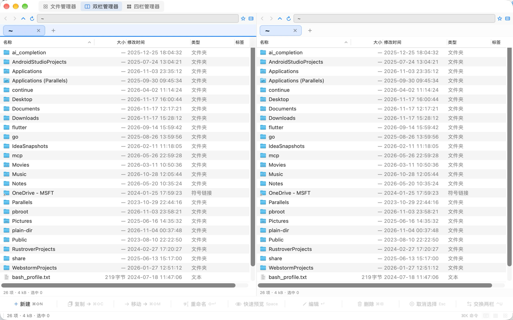

  

<h1 align="center">文件8</h1>

<strong>macOS 原生檔案管理器 · 檔案管理器 / 雙欄 / 四欄三種形態同窗切換</strong>

一套檔案操作核心，三種互動範式 · 寫入操作先預檢 · 三級復原 · 萬項目錄也不卡

  
  
  

<a href="README.md" hreflang="zh-Hans" lang="zh-Hans">简体中文</a> · <strong>繁體中文</strong> · <a href="README.en.md" hreflang="en" lang="en">English</a> · <a href="README.ja.md" hreflang="ja" lang="ja">日本語</a> · <a href="README.ko.md" hreflang="ko" lang="ko">한국어</a> · <a href="README.de.md" hreflang="de" lang="de">Deutsch</a> · <a href="README.fr.md" hreflang="fr" lang="fr">Français</a> · <a href="README.es.md" hreflang="es" lang="es">Español</a> · <a href="README.pt-BR.md" hreflang="pt-BR" lang="pt-BR">Português (Brasil)</a> · <a href="README.ru.md" hreflang="ru" lang="ru">Русский</a> · <a href="README.vi.md" hreflang="vi" lang="vi">Tiếng Việt</a> · <a href="README.id.md" hreflang="id" lang="id">Bahasa Indonesia</a> · <a href="README.ms.md" hreflang="ms" lang="ms">Bahasa Melayu</a> · <a href="README.th.md" hreflang="th" lang="th">ไทย</a>

---

## 這是什麼

文件8 是一個在 macOS 上獨立執行的**檔案管理器**，把「檔案管理器」「雙欄管理器」「四欄管理器」三種互動範式裝進同一個視窗，按 `⇧⌘D` 一步循環切換。三種形態各自儲存現場——路徑、標籤、排序方式、欄寬、選取項目，來回切都不會遺失。

它不是 Finder 的替代品，也不是另一個 Finder 面板。它補的是 Finder 缺的那一塊：**雙手在鍵盤上的批次搬移**。

參照的是經典雙欄檔案管理器範式：不設定預設開啟程式、不做 Finder 延伸功能、不讀寫 Finder 偏好設定。唯一共用的是檔案系統本身。所以它可以和 Finder 長期並存，不會互相干擾。

---

## 介面

### 檔案管理器：網格檢視與詳細面板

### 雙欄管理器：來源與目標兩欄

### 四欄管理器：田字 2×2 佈局

---

## 特色

### 寫入操作先預檢，絕不亂寫

複製、搬移、覆蓋之前先做一次 dry-run：目標是否可寫、磁碟空間夠不夠、有哪些檔名衝突，全部先攤給你看。**這一步不寫任何位元組。**

四種衝突策略任選：取代（先備份，支援復原）、兩者都保留、跳過、逐條詢問。衝突不超過 5 條時可以逐條決定。

進度有即時速度、已傳 / 總量 / 剩餘；結束後給一份完整的帳——成功幾項、跳過幾項、失敗幾項，失敗清單逐個列出檔名與原因。

### 三級復原

同卷宗搬移、重新命名、刪除到垃圾桶、打包與解壓 ZIP **保證 100% 可復原**。複製與跨卷宗搬移盡力而為。不可復原的操作執行前二次確認。

### 六種檢視與專業預覽

特大 / 大 / 中 / 小圖示、列表、詳細資訊。圖示按真實像素分級（256 / 128 / 64 / 32），高解析度螢幕上不模糊。

按 `Space` 快速預覽，`←` / `→` 與 `PgUp` / `PgDn` 連續翻頁：

- 文字與原始碼走唯讀等寬檢視，帶 50 多種語言的語法著色與行號
- PDF 走 PDFKit
- 圖片等比縮放整張裝進面板
- 富格式交給系統 Quick Look
- 預覽不了的，直接給簡介

### 打包與解壓

**打包為 ZIP**：ZIP64、可調壓縮等級、已壓縮格式自動跳過、可選擇是否跟隨符號連結，打包結果可復原。

**按兩下即解壓**，行為與 Finder 一致：單一頂層目錄不套殼、衝突整包改名、只清理 `__MACOSX`，還原 Unix 權限位。

### SSH 遠端目錄

內建 SSH / SFTP：用密碼或任意路徑的私鑰連伺服器，遠端目錄和本機目錄一樣瀏覽、複製、刪除、改名、復原，走同一條寫入管線。

標籤列用網路磁碟圖示加紅綠狀態表示連線狀況，斷線可一鍵重連。**密碼可以不儲存**，改為每次連線彈出一次性登入框。遠端檔案 10 MB 以內也能快速預覽。

### 細節

- Finder 七色標籤，支援多標籤疊加，取消全部標籤時保留自訂文字標籤
- 命令面板 `⌘K`，按符合度 → 最近使用 → 字母序排序
- 路徑三件套：複製路徑、複製所在目錄路徑、複製檔名，外加「在終端機中開啟」
- 計算校驗和：SHA-256 / SHA-512 / SHA-1 / MD5 / BLAKE3 / CRC32 / CRC64
- 卷宗自動探索：USB 隨身碟、外接硬碟、已掛載的磁碟映像自動出現，可一鍵退出
- 工作階段恢復：視窗位置、標籤、欄寬、排序、兩欄比例都記住；當機後能恢復排隊中的寫入任務
- 與 Finder 雙向複製貼上，三個方向拖放打通
- 語言切換在選單列一級「語言」選單，一步可到，切換立即生效

### 14 種語言

簡體中文、繁體中文、英文、日文、韓文、德文、法文、西班牙文、巴西葡萄牙文、俄文、越南文、印尼文、馬來文、泰文。

泰文單獨實作了一套排序規則——前置母音、聲調符號、腳本順序都不是碼位序，按碼位排會亂。

---

## 隱私

**不蒐集任何資料。** 沒有帳號，沒有統計分析，沒有廣告 SDK，沒有當機回報。

除你主動發起的 SSH 連線外，應用程式不向任何伺服器傳送任何位元組。你的檔案、瀏覽記錄、伺服器憑證都只留在你自己的 Mac 上：密碼與私鑰通行碼存在系統鑰匙圈，私鑰檔案始終留在你放它的地方。

應用程式開啟 App Sandbox，只在你授予的目錄範圍內讀寫，不申請通訊錄、相機、麥克風、螢幕錄製或完全磁碟存取。

[詳見隱私政策](privacy.zh-Hant.html)

---

## 支援

遇到問題、想提建議、或發現 bug？

- 開啟[支援頁面](https://rosesmall2010.github.io/FileExplorer8/)查看常見問題
- 在 [Issues](https://github.com/rosesmall2010/FileExplorer8/issues) 裡提交，附上 macOS 版本、文件8 版本號與重現步驟

版本號在「文件8 › 關於文件8」裡可以看到。

### 常見問題

**為什麼進入某些目錄會彈窗要求授權？**
應用程式開啟了 App Sandbox。桌面、下載、文件、外接磁碟等位置在沙盒之外，首次進入某個目錄時 macOS 會強制彈窗詢問，這是系統的安全設計，不是缺陷。選擇「授權此資料夾」後，該目錄會被記住，同一路徑一次執行只問一次。

**會不會讀取我的通訊錄、相機或螢幕？**
不會。文件8 只申請了使用者選擇的檔案存取、標準資料夾（下載 / 文件 / 音樂 / 圖片 / 影片）與對外網路存取，沒有通訊錄、相機、麥克風、螢幕錄製或完全磁碟存取權限。

**SSH 密碼存在哪裡？**
存在 macOS 系統鑰匙圈裡。伺服器端點資訊存在本機沙盒容器內（AES-256-GCM 加密）。密碼可以不儲存，改為每次連線時彈出一次性登入框。詳見<a href="privacy.html">隱私政策</a>。

**支援 Apple Silicon 和 Intel 嗎？**
兩者都支援，安裝包是通用二進位。系統要求 macOS 15.0 或更高版本。

**解除安裝後殘留資料怎麼清理？**
刪除應用程式後，再刪除 <code>~/Library/Containers/com.donghuazhu.FileExplorer8/</code> 即可清空偏好、工作階段記錄與伺服器端點資訊（沙盒應用程式的資料都在你自己的容器裡，不在系統共用位置）。SSH 密碼存在系統鑰匙圈，刪除對應連線時會一併刪除。

---

## 系統需求

- macOS 15.0 或更高版本
- Apple Silicon 或 Intel 晶片（通用二進位）

---

macOS 是 Apple Inc. 的商標。本應用程式與 Apple Inc. 無關聯。

